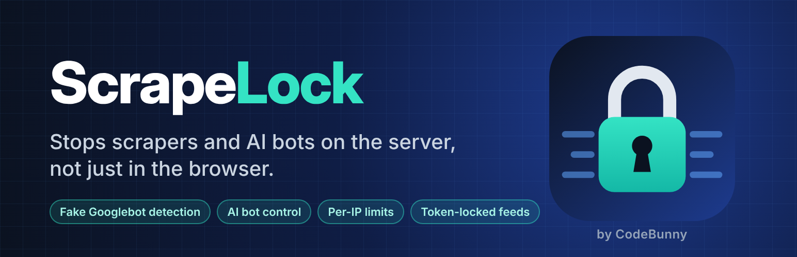
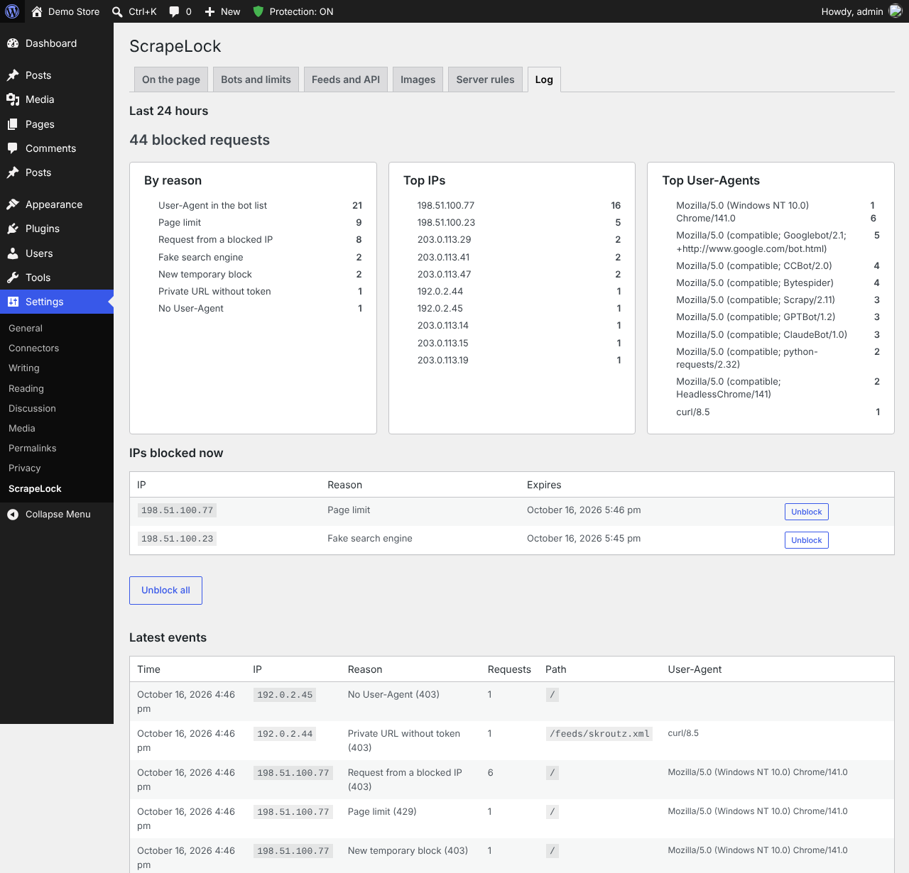
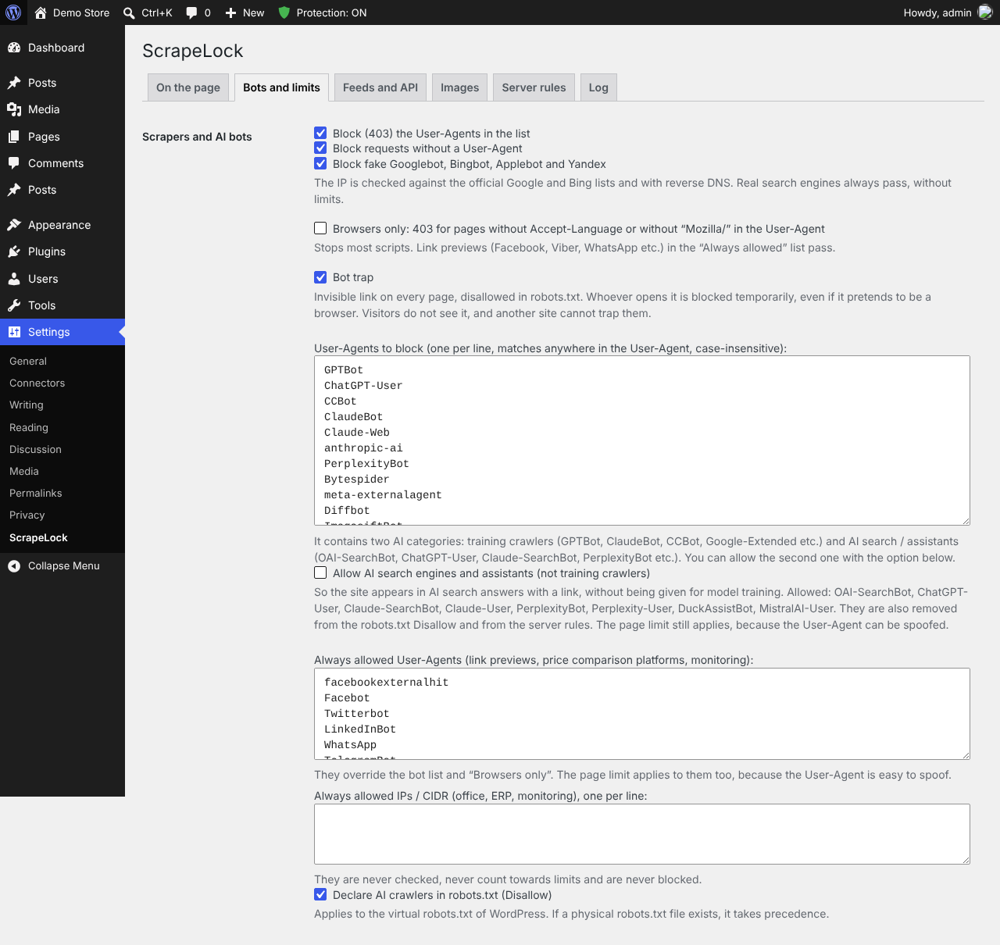
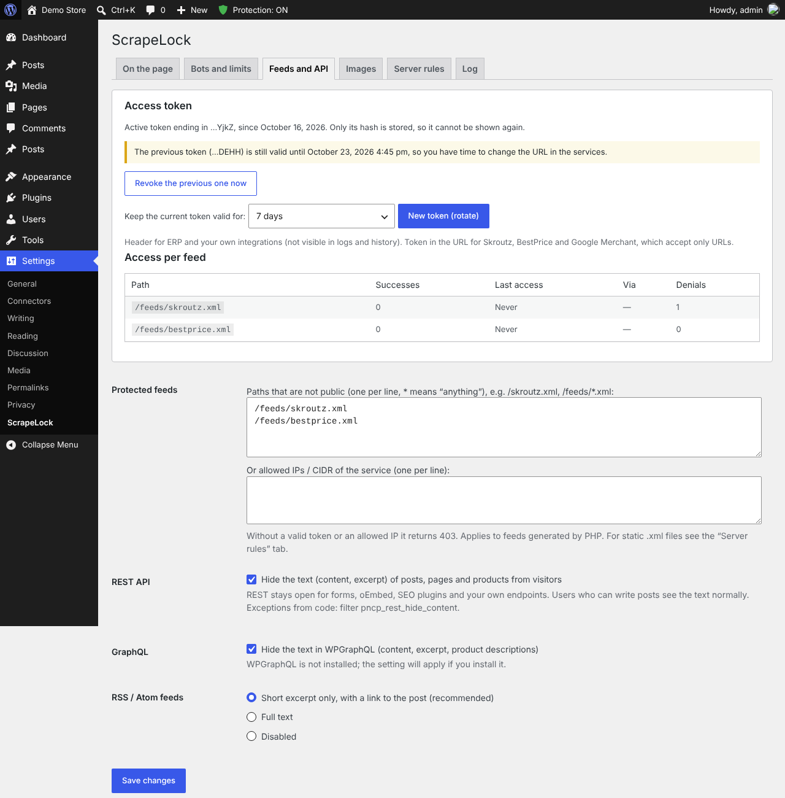
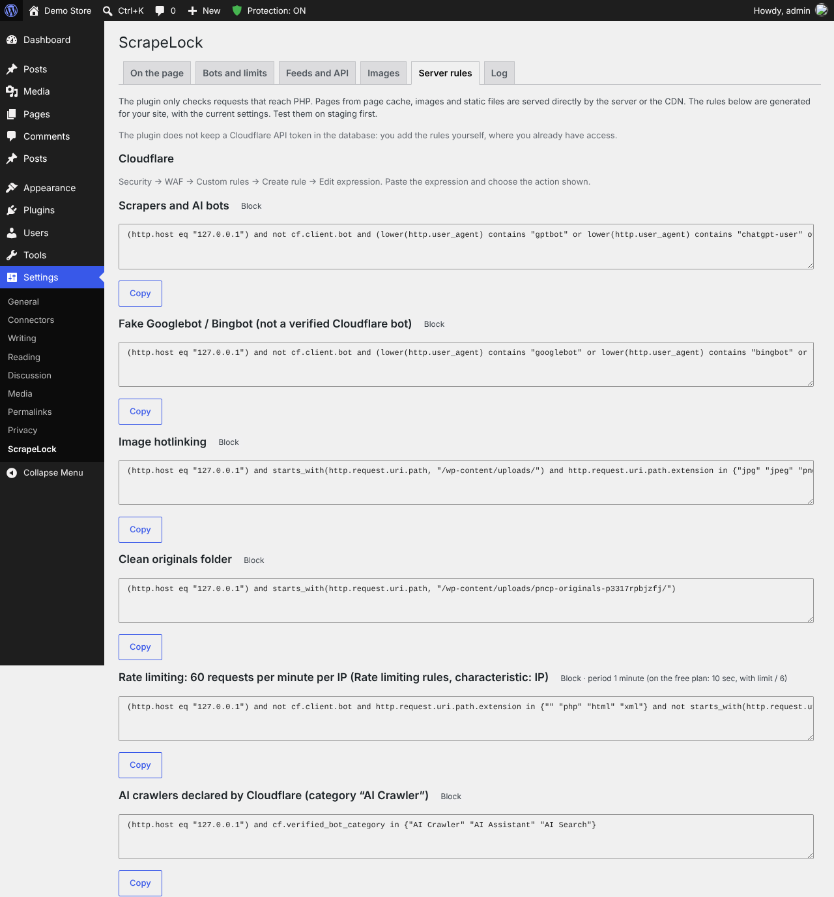
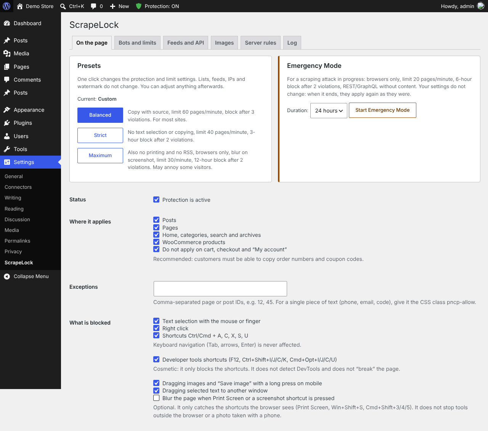
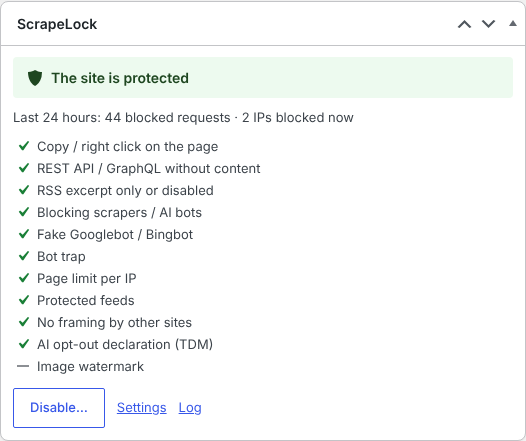

<p align="center">
  
</p>

# ScrapeLock – Content & AI Bot Protection

Server-side anti-scraping and site lockdown for WordPress and WooCommerce, by **CodeBunny**. Formerly **Content Protect**.

Most content protection plugins disable right click in the browser. Scrapers and AI crawlers never use a browser, so they are not affected. ScrapeLock works on the server, where automated copying actually happens, and keeps real visitors, customers and search engines unaffected. **Lockdown** adds what no firewall does: once you are logged in, nothing can be changed until you unlock the site with a code from your phone.

- **Free, GPL-2.0-or-later.** No premium version, no license checks, no tracking.
- **WordPress 6.2+** (tested up to 7.2), **PHP 7.4+**, WooCommerce-aware.

## Features

### Bots and limits
- **Real search engines vs. fakes.** Googlebot, Bingbot, Applebot and Yandex are verified against their official IP lists and with reverse + forward DNS. Real crawlers are never limited; impostors get a 403.
- **AI training vs. AI search.** Training crawlers (GPTBot, ClaudeBot, CCBot, Google-Extended, Bytespider…) are blocked; AI search assistants (OAI-SearchBot, ChatGPT-User, PerplexityBot…) can be allowed with one option and verified against their official IP lists.
- **Per-IP limits** for pages, searches, REST / GraphQL, 404s and sitemaps (IPv6: per /64), with temporary blocks for repeat offenders and an invisible bot trap.
- **Human check** without a captcha: a light proof-of-work after the first real interaction; visitors without it get a stricter limit, not a block.
- **Headless and fake browsers** that reveal themselves in their headers are blocked.
- **Country rules** from Cloudflare's or Bunny CDN's country header, or the free DB-IP Lite database.
- **Real visitor IP** behind Cloudflare, Bunny CDN or your own proxy, trusted only when the request really comes from it.

### Content, feeds and API
- **Text hidden from the REST API, WPGraphQL and full-text RSS** for visitors.
- **Private XML feeds** (price comparison sites, Google Merchant, ERP) protected with a token in a header or the URL. Only the token hash is stored; rotation with a grace period.
- Optional: hide the REST API index from visitors, turn off pingbacks, and see which REST routes anyone can call.
- Usernames hidden from `?author=N`, the users endpoint, the sitemap and oEmbed.

### On the page and images
- Copy, right click, drag and print protection (or copy with a source link), blur on screenshot shortcuts, no framing by other sites.
- Machine-readable AI opt-out (TDM): header, meta tag and `/.well-known/tdmrep.json`.
- Watermarks, never applied twice, with the clean original kept.

### Server and CDN
- Ready-made **Nginx, Apache and Cloudflare rules** generated for your own site and settings.
- Optional **early check** (mu-plugin) and **pre-cache check** (one line in `wp-config.php`) so pages served from a page cache are protected too.
- **Emergency Mode:** one click for stricter limits during an attack, for 1 hour to 3 days.

### Lockdown
Freeze the whole site with one click and a code from your authenticator app (Google Authenticator, Microsoft Authenticator, Authy…).

- While locked, users with a frozen role keep only `read`: nobody can install, update or activate plugins and themes, run updates, use the file editor, add users or administrators, change roles, staff emails or passwords, settings or content, from wp-admin, the REST API or XML-RPC.
- Enforced against code too: protected options (active plugins, theme, site address, admin email, registration, default role, user roles), role changes, staff email and password changes, password resets and new application passwords are refused while locked.
- Visitors, customers, orders, payments, webhooks, cron jobs and members who post their own content keep working.
- TOTP (RFC 6238), each code accepted once even under concurrent requests (database compare-and-set), the secret encrypted with libsodium using the keys in `wp-config.php`, ten one-time recovery codes stored only as hashes, wrong-code limits and an email on every unlock.
- Temporary unlock (15 minutes to 2 hours, then it locks again by itself). A clear "The site is locked" page with an unlock button for administrators.
- No WP-CLI command and no ability can unlock it.

Lockdown complements a firewall such as Wordfence: the firewall and two-factor login guard the door, Lockdown guards what happens after someone is inside, for example with a stolen session cookie.

### Tools
- **Site Health** tests and a ScrapeLock section on the Info tab.
- **WP-CLI:** `wp scrapelock status | block | unblock | blocked | emergency | log`.
- **Abilities API** (WordPress 6.9+): `scrapelock/get-summary`, `block-ip`, `unblock-ip`, `emergency-mode`, for administrators only.
- Block log with a 24-hour summary, top IPs, User-Agents and the pages scrapers were after.

Forms, cart, checkout, the WooCommerce Store API and payment webhooks are never affected.

## Screenshots

| | |
|---|---|
|  |  |
| Block log: summary by reason, top IPs and User-Agents | Bots and limits: AI crawlers, fake search engines, bot trap |
|  |  |
| Token-protected feeds, text hidden from REST, GraphQL and RSS | Cloudflare, Nginx and Apache rules for your own site |
|  |  |
| Presets, Emergency Mode and on-page protection | Dashboard widget: protection status and the last 24 hours |

## Installation

1. Download **`scrapelock.zip`** from the latest [release](../../releases/latest).
2. In WordPress: **Plugins → Add New → Upload Plugin**, choose the zip, then **Activate**.
3. Open **Settings → ScrapeLock**, pick a preset (Balanced is a good start) and check the **Real visitor IP** setting if your site is behind a CDN.

The full description for the WordPress.org directory is in [`readme.txt`](readme.txt). A user guide in Greek is in [`docs/user-guide-el.md`](docs/user-guide-el.md).

### Upgrading from Content Protect

Deactivate Content Protect (folder `content-protect`) and activate ScrapeLock. Settings, feed tokens and the block log are kept. If you pasted the old Apache rules, replace the `# BEGIN Content Protect` block with the new `# BEGIN ScrapeLock` block from the "Server rules" tab.

## Repository layout

| Path | Contents |
|---|---|
| `scrapelock.php`, `includes/`, `assets/`, `languages/`, `uninstall.php`, `readme.txt` | The plugin, as installed in `wp-content/plugins/scrapelock/` |
| `tests/` | Tests on a real WordPress (HTTP, watermark, admin, Lockdown, WP-CLI) and in Chromium |
| `translations/` | Greek translation (`.po`), for translate.wordpress.org |
| `wporg-assets/` | Icon, banner and screenshots for the WordPress.org page |
| `docs/` | User guide in Greek |
| `CHANGELOG.md` | Changes per version |

GitHub's **Download ZIP** and `git archive` contain only the plugin (`.gitattributes` leaves the rest out), but the folder from Download ZIP must be renamed to `scrapelock` before installing.

## Build and checks

```sh
mkdir -p dist
git archive --format=zip --prefix=scrapelock/ -o dist/scrapelock-$(sed -n 's/^ \* Version: *//p' scrapelock.php).zip HEAD
phpcs                 # WordPress Coding Standards (phpcs.xml.dist)
cd tests && WP_DIR=/path/to/wordpress BASE=http://127.0.0.1:8099 ./run-all.sh
```

The same checks run on GitHub Actions for every pull request (`.github/workflows/ci.yml`). The plugin zip is kept as an artifact for 3 days, then deleted automatically. The plugin passes the official WordPress Plugin Check with no errors and no warnings.

To publish a release: **Actions → Release → Run workflow** on `main`, or push a version tag such as `v2.8.2`. `.github/workflows/release.yml` checks that the version matches `Version`, `PNCP_VERSION` and `Stable tag`, builds the zip and attaches it to the release.

## Privacy

When a request is blocked, its IP address, User-Agent, page and time are logged and deleted automatically after 1, 7 or 30 days. Public IP lists (search engines, CDNs, AI search providers) are downloaded only when the related settings are on; no site or visitor data is sent anywhere. Details are in the "External services" section of [`readme.txt`](readme.txt).

## License

[GPL-2.0-or-later](LICENSE) © CodeBunny
